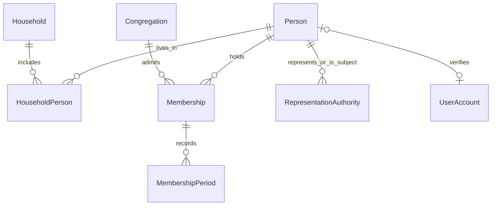

# Relationship map and cross-department handoffs

Read an arrow as a relationship between business records. Many relationships are dated or qualified, and their join records carry that information. The diagrams show the primary paths. Each domain dictionary also specifies optional participants, valid dates, correction rules and scoping.

## People, households and authority

Record both the actor and the subject of RepresentationAuthority. Scope and effective dates determine what the actor can do. The login relationship shown is the currently verified personal account in the organization. A historical link, an invitation awaiting proof and a system integration have separate records.

## How a service registration reaches three owners

An occurrence belongs to the ministry calendar. Each RegistrationPlace belongs to one registration and identifies the place to admit or release. A provider may report a payment covering two places and an optional gift. Match the components independently. A payment acknowledgement carries no authority to admit above capacity, release a child or change a donor's designation.

| Relationship | Identity to keep | Correction route |
| --- | --- | --- |
| Occurrence → registration → place | Church, occurrence, registration revision, place and current hold or confirmed allocation | Organizer reviews an expired hold or capacity conflict; release only the affected place. |
| Payment evidence → place | Provider connection, operation and component, amount, currency, provider status and linked AdmissionPaymentNotice | Repeated delivery reuses the result. Late confirmation after cancellation needs a decision on the place and an external refund request where applicable. |
| Payment evidence → gift → designation | Independently identified gift component, donor preference or anonymity, separate allocations and source evidence | A fee refund cannot reverse a gift. A gift correction links to the original; the giving desk reports the difference to the accountant. |
| Church handoff → external books | Destination, source revision, mapping, currency, amount, accepted or rejected receipt and approved external reference | The external accounting service handles posting and reconciliation. The church tracks the status of each handoff and can operate while an acknowledgement is pending. |

## Contract checklist

| Event and responsible writer | Minimum handoff | Receiver, replay and correction |
| --- | --- | --- |
| Registrar confirms or ends membership | Organization, person, congregation, membership period, decision revision, effective date, purpose | Eligibility and reporting can re-evaluate as-of dates. Frozen voting lists and certified returns accept controlled revisions, never silent updates. |
| Guardian authority changes | Scope, subject and authority references, allowed action, effective expiry, revision | Identity, member self-service and check-in invalidate projections. A station with stale authorization must obtain current verification for a contested handover. |
| Organizer changes an occurrence | Occurrence id and old/new revision, local time and zone, capacity/location, approved audience and message purpose | Reservations recheck conflicts; communication cancels obsolete reminders and deduplicates corrections. Attendance already recorded remains associated with the original occurrence. |
| A payment provider confirms or reverses a movement | Scoped provider receipt, source component, amount, currency, effective time and correlation key | Admissions reconciles the named place, giving reconciles any separate gift, and the accounting service acknowledges its own work. Retry each failed recipient independently. |
| Aid team authorizes a disbursement | Award and instalment id, fund, payee, value/unit, expiry, approval and permitted destination | Inventory or finance returns one execution reference or exception. Returned or unclaimed value is a linked adjustment. Narratives stay restricted. |
| Board confirms a decision | Body, meeting, resolution id, authority, exact wording, cap/currency, responsible person and due date | Action owners can request a purchase or work order inside authority. The board resolution alone cannot issue payment. Post-completion evidence goes back to the action. |
| Supervisor approves staff time or an absence | Engagement, approved period and units, revision and source key | External payroll confirms or returns the handoff. A correction references the accepted source. Staffing and ordinary member access remain under the church’s authority. |
| Provider reports delivery status | Sender route, dispatch-recipient, provider/message reference, observation time, status and failure class | Communications matches the exact attempt, preserves out-of-order evidence and keeps an unknown outcome distinct from hard failure or proof of reading. |
| Protected record is withdrawn or publication rights expire | Owner, object revision, scope, effective instant and recall instruction | Media, search, print queues, cached previews, scheduled exports and assistant retrieval re-evaluate. Record copies already issued and the limits of recall. |

A receiver that cannot resolve a reference, currency, scope or version records a recoverable exception. Domain owners reconcile counts and amounts over a named cutoff. Conflicting payloads with the same key are quarantined for review. Sensitive event bodies contain references and approved minimum facts. Inspection, replay and dead-letter views require access to the same information in the originating domain.

See [API and MCP integrations](../platform/church-apps-and-integrations.md), [people](../people/README.md), [registration](../ministry/registration.md), [church desk handoffs](../commerce/README.md) and [accounting exchange](../finance/accounting-exchange.md).
