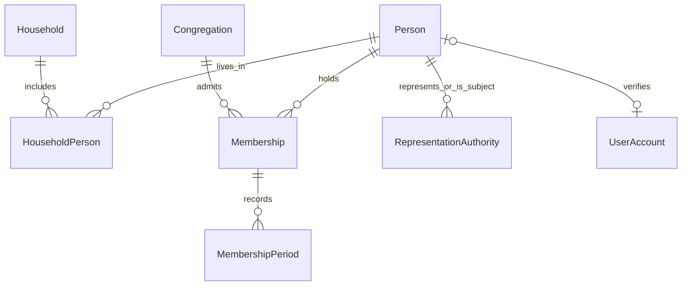
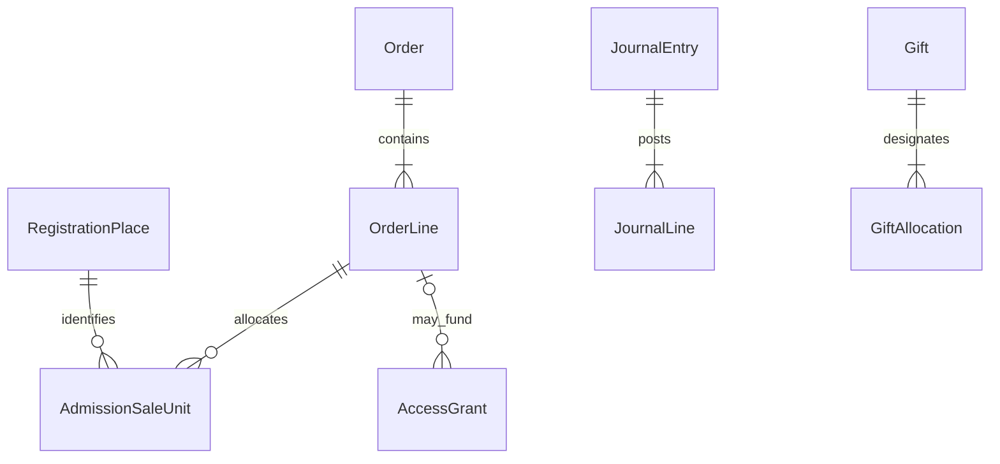

# Relationship map and cross-department handoffs

Read an arrow as a relationship between business records. Many relationships are dated or qualified, and their join records carry that information. The diagrams show the primary paths. Each domain dictionary also specifies optional participants, valid dates, correction rules and scoping.

## People, households and authority

Record both the actor and the subject of RepresentationAuthority. Scope and effective dates determine what the actor can do. The login relationship shown is the currently verified personal account in the organization. A historical link, an invitation awaiting proof and a system integration have separate records.

## A purchase crossing several departments

The posting and gift records have their own lifecycles. An accepted handoff carries the capture, component, book, operation key and posting purpose. The treasurer can reconcile the capture once across the order, receipt, settlement, refund and general ledger.

## Contract checklist

| Event and responsible writer | Minimum handoff | Receiver, replay and correction |
| --- | --- | --- |
| Registrar confirms or ends membership | Organization, person, congregation, membership period, decision revision, effective date, purpose | Eligibility and reporting can re-evaluate as-of dates. Frozen voting lists and certified returns accept controlled revisions, never silent updates. |
| Guardian authority changes | Scope, subject and authority references, allowed action, effective expiry, revision | Identity, member self-service and check-in invalidate projections. A station with stale authorization must obtain current verification for a contested handover. |
| Organizer changes an occurrence | Occurrence id and old/new revision, local time and zone, capacity/location, approved audience and message purpose | Reservations recheck conflicts; communication cancels obsolete reminders and deduplicates corrections. Attendance already recorded remains associated with the original occurrence. |
| Finance confirms payment or reversal | Immutable capture/settlement/refund id, component amounts and currencies, book, effective date and cross-domain operation key | Admissions and media update specific units or grants. Giving receives the gift component. Define a single cash-posting owner per capture. Resolve a failed receiver independently. |
| Aid team authorizes a disbursement | Award and instalment id, fund, payee, value/unit, expiry, approval and permitted destination | Inventory or finance returns one execution reference or exception. Returned or unclaimed value is a linked adjustment. Narratives stay restricted. |
| Board confirms a decision | Body, meeting, resolution id, authority, exact wording, cap/currency, responsible person and due date | Action owners can request a purchase or work order inside authority. The board resolution alone cannot issue payment. Post-completion evidence goes back to the action. |
| Staff time or leave is approved | Engagement, paid period, earning code, hours or value, approval, cost split and source key | Payroll validates rates and creates one input. A payslip or closed period uses a subsequent correction with the original evidence. |
| Provider reports delivery status | Sender route, dispatch-recipient, provider/message reference, observation time, status and failure class | Communications matches the exact attempt, preserves out-of-order evidence and keeps an unknown outcome distinct from hard failure or proof of reading. |
| Protected record is withdrawn or publication rights expire | Owner, object revision, scope, effective instant and recall instruction | Media, search, print queues, cached previews, scheduled exports and assistant retrieval re-evaluate. Record copies already issued and the limits of recall. |

A receiver that cannot resolve a reference, currency, scope or version records a recoverable exception. Domain owners reconcile counts and amounts over a named cutoff. Conflicting payloads with the same key are quarantined for review. Sensitive event bodies contain references and approved minimum facts. Inspection, replay and dead-letter views require access to the same information in the originating domain.

See [integration contracts](../platform/exchange-events.md), [people](../people/README.md), [registration](../ministry/registration.md), [commerce](../commerce/README.md) and [financial controls](../finance/controls.md).
